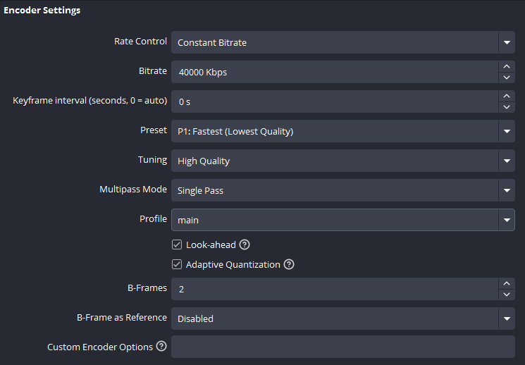

# GigaMux
Universal, instant, Visually Lossless bulk re-encoder made in Rust, with ffmpeg as the backend. Built for reducing the file size of OBS recordings and Twitch vods, without losing any perceptible data.

## Usage

### Overview & Use Case
The intention is to trim unnecessary data from video files that were made heavy on purpose; live encodes generally target a Constant Bitrate (CBR) with a fast preset in order to record as much detail within a specified bitrate/overhead budget. For example:

This OBS encoder setup sacrifices disk space for quality (40mbps) without overwhelming the encoder (P1: Fastest). There are many great applications for this style of encode setting, but this will obviously take up an unnecessary amount of space. Twitch VODs have a lower bitrate as per their [Broadcasting Guidelines](https://help.twitch.tv/s/article/broadcasting-guidelines?language=en_US), but there's still likely to be a large amount of excess data in them, because encoding visually lossless VBR requires more resources, and while streaming protocols support it, VBR is discouraged or rejected on streaming *platforms* for QoS reasons.

Thus, GigaMux will re-encode your input file with `CQ=0`/`CRF=0` (same target, different name and logic depending on the output codec) with the maximum bitrate set from the average rate of the original file (though this can be overridden, if preferred). This way, the visual quality is completely preserved (to the best of the destination codec's ability).

This is a **LOSSY** encode target. For most applications (Downloaded Twitch VODs & local OBS recordings with CBR) there will be no perceptible difference in quality, but the output is still removing data that was included in the input. The question for the user is whether that input matters to them more than storage. For most Twitch streamers or archivists, storage is a constraint that matters more, due to the astronomical size that VODs can reach.

Audio is copied directly from the source to the destination, unless the destination container is incompatible, in which case the audio will be recoded to a compatible codec. The UI will warn if this will occur on render.

### Codec, Encoder, & Container

Codec choice depends entirely on your hardware, time budget, and end goal. Generally, you should be encoding to the most quality-efficient codec. Software (CPU) encoding is always better in this regard. It is also universally slower. To assist with this, [Flamenco](https://flamenco.blender.org/) farm submit is available (stock worker + [`flamenco/GigaMux.js`](flamenco/GigaMux.js); see [docs/flamenco.md](docs/flamenco.md)). **Deploy assumes the Manager install is on shared storage** so workers can run `tools/gigamux-check` from that path; otherwise set **Worker check helper** in Settings → Files to a shared location. Encoding with hardware, especially Nvidia's Nvenc, is much faster for local work. For information regarding what your GPU is capable of, consult [this page](https://en.wikipedia.org/wiki/NVENC#Versions).

It's best to test a short encode in whatever your workflow is, before committing to any given combination of Codec, Encoder, and container. Not all software and hardware has support for every codec or container natively, and may require plugins or manual configuration in order to function properly. (e.g. Adobe Premiere Pro does not support `.webm`/`vp9` or `AV1` in any codec natively; I use [Autokroma's Influx](https://www.autokroma.com/Influx) importer for both; Windows may not support playback universally and might need a 'video extensions' Microsoft Store installation on a per-codec basis) In any case, use the codec/encoder/container that is best supported by your hardware, software, and preference.

Your codec choices in GigaMux:
- `AV1`: Highest CQ0 quality ceiling among the options here, and the default. Recommended when your GPU has AV1 NVENC (Ada / 40-series or newer) or when you are fine with software `libaom-av1`. On NVENC, CQ0 is automatic per codec: HEVC and AV1 decide per-frame spend differently under the same “CQ0,” so there is no CQ value that makes AV1 match HEVC’s strategy for a given input. At the *GigaMux Target* (CQ0 + auto maxrate from the source; see [Comparing NVENC AV1 and HEVC](docs/codec-efficiency.md)), nvAV1 usually lands a bit larger than nvHEVC for a slightly higher VMAF. Tradeoffs versus HEVC go through Maxrate, not CQ matching; with a Maxrate override, AV1 can *beat* uncapped HEVC on both VMAF and size. In NVENC testing, nvAV1 was also *much faster* than nvHEVC. For Replay-class OBS footage, try ~`18000` kbps if you want HEVC-like quality in a smaller file; your clips will vary, so no default Maxrate is shipped.
  - Supports containers `.mp4`, `.mkv`
- `HEVC`: Strong default **size** pick on NVENC when you want CQ0 without tuning a cap, and the usual recommendation on Ampere (30-series) or older (no AV1 NVENC). Software via `libx265`. Allegedly supports alpha, but not with vanilla ffmpeg, and most softwares don't support it anyway.
  - Supports containers `.mp4`, `.mkv`
- `VP9`: Somewhat efficient, but not necessarily worth the time. This is the only option for alpha support, because it's the only lossy codec with a crf0 target that supports alpha. No real hardware encoder support (yet). Intel Quick Sync on Intel Arc GPUs or post-Ice Lake CPUs have hardware encoders supported via ffmpeg `vp9_qsv` or `vp9_vaapi`, but I haven't been able to test on any yet. So it's software only for now, via `libvpx-vp9`.
  - Supports containers `.mp4`, `.mkv`, `.webm`
- `AVC`/`H.264`: Denoted as `H.264` in GigaMux due to it being the more common name for `AVC`. Not strongly recommended if your nvenc generation is less than 5th gen (Maxwell 2.0; 900 series) but still a strong option for maximum deliverability; it's one of the longest-living codecs and has wide support on just about everything that can play video. Software encoding via ol' reliable `libx264`.
  - Supports containers `.mp4`, `.mkv`

### Requirements

- Windows desktop app (egui shell in this repo).
- `ffmpeg` on `PATH`. Encoding works with a normal build; **VMAF** needs a full build that includes the `libvmaf` filter (e.g. [gyan.dev full](https://www.gyan.dev/ffmpeg/builds/)).
- Hardware encode (NVENC / QSV where available) is optional; software encoders are always selectable. GigaMux probes NVENC Compute SM → generation (and QSV when present). With **multiple** NVENC GPUs, each Targets row (including each test slot) can pick a different device/gen. Optional **Write encoder metadata** (default on) stamps `GigaMux_encoder` / `GigaMux_hw` into outputs.

### Quick start

1. Set **Input** and **Output** folders (`Change…` on each path row).
2. Pick Opaque targets (codec / container / Use hardware). Alpha targets are ignored unless an input has Alpha (only use if you need VP9 with transparency).
3. Leave Maxrate empty for the GigaMux Target (CQ0 + auto ceiling from the source average bitrate), or type a kbps override.
4. Select files and **Encode** (or press **F12**). Right-click a row to encode one file. Existing outputs are skipped unless you force them.
5. **Check** so you know your outputs are intact.
6. Use VMAF to get scores for your outputs. Option for minmaxers, quite useful for test mode so you can choose a target.

### Test mode

Enable **Test mode** on the Output path row (next to Change…). Choose **2–4 Target Slots** (default 2). Each selected input encodes once per slot, sequentially, into the same folder:

- `test1_{stem}.{ext}` … `test4_{stem}.{ext}` for the active slot count

The Output column shows a compare strip (size Δ vs the original input; VMAF score vs input with ↑/↓ vs Test1) and a scrollable list of collapsing panels per slot, each with independent codec, container, hardware, Maxrate, and (when multi-GPU) NVENC device/generation. Use this to A/B Maxrate caps or GPU gens (e.g. HEVC on Test1 vs AV1 + ~18000 kbps on Test2) before a full batch; see [Comparing NVENC AV1 and HEVC](docs/codec-efficiency.md). Local GPU pick only — farm worker-gen tags are separate.

Navigation while Test mode is on (Output list):

- `←` / `→` - jump by stem, prefer Test1
- `Shift+←` / `Shift+→` - cycle prefer among active slots, then pair-jump
- `Shift+↑` / `Shift+↓` - cycle sibling test files for the same stem

### Check & VMAF

- **Check** probes each selected pair and opens a severity tree (High / Medium / Low). Medium findings stay listed with the checkbox off by default.
- **VMAF** scores input → output via `libvmaf`. In Test mode it scores each active `testN_*` against the source so you can compare slots.

### Shortcuts

| Key | Action |
| --- | --- |
| `F12` | Encode selection |
| `F5` | Reload / re-index folders |
| `Ctrl+F5` | Wipe preview cache, then re-index (can be heavy; wipes expensive VMAF results) |
| `←` / `→` | Jump to paired file (Input ↔ Output; Test mode prefers Test1) |
| `Shift+←` / `Shift+→` | Test mode: cycle prefer among active slots, then pair-jump |
| `Shift+↑` / `Shift+↓` | Test mode Output: cycle sibling among active `testN_*` |
| `Ctrl+Z` | Undo delete / rename |
| `Ctrl+J` | Expand/toggle log |

## Contributing

See [CONTRIBUTING.md](CONTRIBUTING.md).
