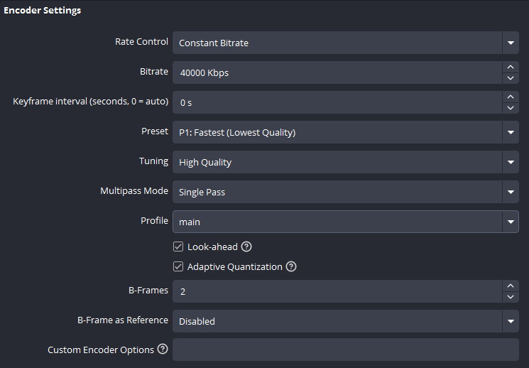

# GigaMux
Universal, instant, Visually Lossless bulk re-encoder made in Rust, with ffmpeg as the backend. Built for reducing the file size of OBS recordings and Twitch vods, without losing any perceptible data.

## Usage

### Overview & Use Case
The intention is to trim unnecessary data from video files that were made heavy on purpose; live encodes generally target a Constant Bitrate (CBR) with a fast preset in order to record as much detail within a specified bitrate/overhead budget. For example:

This OBS encoder setup sacrifices disk space for quality (40mbps) without overwhelming the encoder (P1: Fastest). There are many great applications for this style of encode setting, but this will obviously take up an unnecessary amount of space. Twitch VODs have a lower bitrate as per their [Broadcasting Guidelines](https://help.twitch.tv/s/article/broadcasting-guidelines?language=en_US), but there's still likely to be a large amount of excess data in them, because encoding visually lossless VBR requires more resources, and while streaming protocols support it, VBR is discouraged or rejected on streaming *platforms* for QoS reasons.

Thus, GigaMux will re-encode your input file with `CQ=0`/`CRF=0` (same target, different name and logic depending on the output codec) with the maximum bitrate set from the average rate of the original file (though this can be overridden, if preferred). This way, the visual quality is completely preserved (to the best of the destination codec's ability).

This is a **LOSSY** encode target. For most applications (Downloaded Twitch VODs & local OBS recordings with CBR) there will be no perceptible difference in quality, but the output is still removing data that was included in the input. The question for the user is whether that input matters to them more than storage. For most Twitch streamers or archivists, storage is a constraint that matters more, due to the astronomical size that VODs can reach.

Audio is copied directly from the source to the destination, unless the destination container is incompatible, in which case the audio will be recoded to a compatible codec. The UI will warn if this will occur on render.

### Codec, Encoder, & Container

Codec choice depends entirely on your hardware, time budget, and end goal. Generally, you should be encoding to the most quality-efficient codec. Software (CPU) encoding is always better in this regard. It is also universally slower. To assist with this, [Flamenco](https://flamenco.blender.org/) support is planned. But in the meantime, encoding with hardware, especially Nvidia's Nvenc, is much faster, and already used to power the encoding needs of most people. For information regarding what your GPU is capable of, consult [this page](https://en.wikipedia.org/wiki/NVENC#Versions).

It's best to test a short encode in whatever your workflow is, before committing to any given combination of Codec, Encoder, and container. Not all software and hardware has support for every codec or container natively, and may require plugins or manual configuration in order to function properly. (e.g. Adobe Premiere Pro does not support `.webm`/`vp9` or `AV1` in any codec natively; I use [Autokroma's Influx](https://www.autokroma.com/Influx) importer for both; Windows may not support playback universally and might need a 'video extensions' Microsoft Store installation on a per-codec basis) In any case, use the codec/encoder/container that is best supported by your hardware, software, and preference.

Your codec choices in GigaMux:
- `AV1`: Highest CQ0 quality ceiling among the options here, and the default. Recommended when your GPU has AV1 NVENC (Ada / 40-series or newer) or when you are fine with software `libaom-av1`. At GigaMux’s target (CQ0 constrained against a maxrate), nvAV1 always lands a bit larger than nvHEVC with the same maxrate for a slightly higher VMAF (visual quality). With the **Maxrate** override, it can *beat* uncapped HEVC on both VMAF *and* size. In NVENC testing, nvAV1 was also *much faster* than nvHEVC. See [Comparing NVENC AV1 and HEVC](docs/codec-efficiency.md) for more details. Based on my tests, if you want the same quality as nvHEVC auto for a fraction of the size, you should try overriding the auto maxrate with around `18000` kbps. I haven't set a default maxrate because there are too many other variables to test, and each user's input files will vary.
  - Supports containers `.mp4`, `.mkv`
- `HEVC`: Strong default **size** pick on NVENC when you want CQ0 without tuning a cap, and the usual recommendation on Ampere (30-series) or older (no AV1 NVENC). Software via `libx265`. Allegedly supports alpha, but not with vanilla ffmpeg, and most softwares don't support it anyway.
  - Supports containers `.mp4`, `.mkv`
- `VP9`: Somewhat efficient, but not necessarily worth the time. This is the only option for alpha support, because it's the only lossy codec with a crf0 target that supports alpha. No real hardware encoder support (yet). Intel Quick Sync on Intel Arc GPUs or post-Ice Lake CPUs have hardware encoders supported via ffmpeg `vp9_qsv` or `vp9_vaapi`, but I haven't been able to test on any yet. So it's software only for now, via `libvpx-vp9`.
  - Supports containers `.mp4`, `.mkv`, `.webm`
- `AVC`/`H.264`: Denoted as `H.264` in GigaMux due to it being the more common name for `AVC`. Not strongly recommended if your nvenc generation is less than 5th gen (Maxwell 2.0; 900 series) but still a strong option for maximum deliverability; it's one of the longest-living codecs and has wide support on just about everything that can play video. Software encoding via ol' reliable `libx264`.
  - Supports containers `.mp4`, `.mkv`
