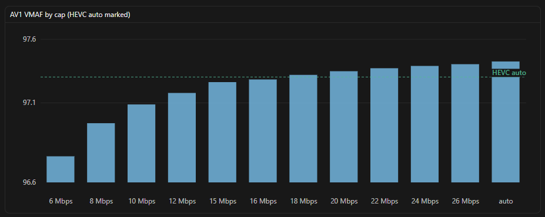
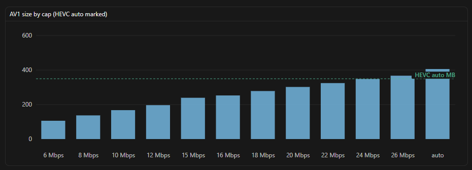

# Comparing NVENC AV1 and HEVC for GigaMux

GigaMux defaults to CQ0 / CRF0 with an automatic maxrate from the source average bitrate, henceforth referred to as the *GigaMux Target*. That preserves visual quality well, but codec choice still changes size and speed. This note covers a Maxrate ladder on nvAV1 versus uncapped nvHEVC for a heavy OBS recording, plus hard/easy diagnostic clips.

## The Issue

The GigaMux Target is usually† smaller than a CBR source. On NVENC, `-cq 0` means *automatic* quality mode, not constant CQ at maximum quality. The same CQ0 label is not the same operating point on AV1 and HEVC: rate/quality curves differ, and the *algorithm* by which CQ0 decides per-frame detail (and thus, bitrate budget) differs between nvHEVC and nvAV1.

nvHEVC ends up smaller than nvAVC at the GigaMux Target mainly because its CQ strategy is in the same *family* as AVC’s, while the actual compression is more efficient. AV1 is more efficient still, but it disagrees on how to set CQ at CQ0, so under the same maxrate it often lands *higher* spend than the weaker codecs, not lower.

There is no CQ override that makes AV1 adopt HEVC’s CQ strategy for a given input. You cannot dial one codec’s automatic mode into the other’s. On easy content, nvAV1 typically spends more than nvHEVC, scores a bit higher on VMAF, and finishes faster. Tradeoffs versus HEVC therefore go through Maxrate, not CQ matching.

†OBS/CBR with a source-based ceiling where VBR can go under it; atypical sources may not shrink.

## Content dependence

Under the same auto maxrate:

- Easy / low-complexity: nvAV1 overspends vs nvHEVC for tiny VMAF gain (OBS Replay ~+16% size; soft synthetic ~+10%). Unused headroom under the shared ceiling is what AV1’s auto CQ fills.
- Hard / high-complexity: both sit on the quality ceiling, so sizes converge or AV1 edges ahead (Xiph crowd_run ~even; incompressible noise: AV1 ~4% smaller, slightly higher VMAF).

This is auto-CQ behavior under a shared ceiling, not an effect of the source codec's family. The Replay that overspent was already HEVC ~40 mbps CBR, same class as the diagnostic masters.

## Test setup

- Ladder source: Desktop Replay Buffer, HEVC ~40 mbps CBR OBS (same encode settings as the README encoder screenshot).
- Ladder encodes: RTX 4080 Super NVENC. nvHEVC at the GigaMux Target; nvAV1 at CQ0 with Maxrate overrides 6–26 mbps plus AV1 at the GigaMux Target.
- Diagnostics: Xiph `crowd_run` / `FourPeople` (pre-capped ~40 mbps HEVC), plus synthetic hard noise and easy soft; HEVC vs AV1 both at the GigaMux Target.
- Scores: libvmaf pooled mean, host `n_threads`, `n_subsample=4`. Awkward AV1 levels used `av1_cuvid` for decode while scoring.

Guidance for these clips and GPU only; smoke-test your own footage.

HEVC GigaMux Target (auto) baseline (Replay): VMAF 97.26, 349.5 MB, ~20 mbps avg.

## Charts

*AV1 size wins through ~24 mbps. Leanest win on both VMAF and size: ~18 mbps. At 26 mbps and AV1 GigaMux Target, quality stays higher but the file exceeds HEVC.*

## Score table (Replay Maxrate ladder)

| Cap | mbps | VMAF | Δ vs HEVC | MB | vs HEVC size | Beats both? |
| --- | ---: | ---: | ---: | ---: | ---: | --- |
| HEVC auto | 19.97 | 97.2628 | — | 349.5 | — | baseline |
| AV1 6 mbps | 6.06 | 96.7641 | −0.4987 | 106.0 | −69.7% | no |
| AV1 8 mbps | 7.83 | 96.9723 | −0.2905 | 137.1 | −60.8% | no |
| AV1 10 mbps | 9.57 | 97.0903 | −0.1725 | 167.5 | −52.1% | no |
| AV1 12 mbps | 11.23 | 97.1625 | −0.1003 | 196.5 | −43.8% | no |
| AV1 15 mbps | 13.66 | 97.2307 | −0.0321 | 239.2 | −31.6% | no |
| AV1 16 mbps | 14.44 | 97.2473 | −0.0155 | 252.7 | −27.7% | no |
| AV1 18 mbps | 15.89 | 97.2762 | +0.0134 | 278.2 | −20.4% | yes |
| AV1 20 mbps | 17.25 | 97.2992 | +0.0364 | 301.9 | −13.6% | yes |
| AV1 22 mbps | 18.53 | 97.3180 | +0.0552 | 324.3 | −7.2% | yes |
| AV1 24 mbps | 19.88 | 97.3324 | +0.0696 | 347.9 | −0.5% | yes |
| AV1 26 mbps | 20.98 | 97.3434 | +0.0806 | 367.2 | +5.1% | no |
| AV1 auto | 23.19 | 97.3606 | +0.0978 | 405.8 | +16.1% | no |

“Beats both” means VMAF ≥ HEVC Target and smaller than HEVC Target.

## Diagnostic set (GigaMux Target)

Already-capped ~40 mbps HEVC masters hide fat-source headroom, but still show hard vs easy spend.

| Clip | Kind | HEVC MB / VMAF | AV1 MB / VMAF | AV1 vs HEVC |
| --- | --- | ---: | ---: | ---: |
| crowd_run | hard (Xiph) | 50.3 / 99.97 | 50.4 / 99.97 | ~0% |
| algo_noise | hard (synthetic) | 247.5 / 78.90 | 236.8 / 79.26 | −4.3% |
| FourPeople | easier (Xiph) | 48.9 / 97.99 | 50.4 / 98.07 | +3.1% |
| algo_soft | easy (synthetic) | 6.8 / 96.53 | 7.5 / 96.87 | +10.0% |
| OBS Replay | easy-ish destkop | 349.5 / 97.26 | 405.8 / 97.36 | +16.1% |

## What we ruled out

- Blanket ~½ maxrate for AV1: hard clips already use the full auto ceiling; halving AV1 would starve it while HEVC keeps the budget on auto.
- Scaling AV1’s ceiling by *source* codec (e.g. H.264 “fat”, HEVC 1.0×): wrong lever here. Overspend cases were HEVC sources under the same ceiling; HEVC→1.0 is a no-op. Not productized.
- Constant CQ as the size fix: `-cq 0` is automatic; fixed CQ (e.g. 2) can spend *more* than automatic under the same maxrate. With the per-codec CQ0 strategy gap above, Maxrate is the control, not CQ matching.

## Takeaways

1. AV1 at the GigaMux Target is size-costly on easy footage. On the Replay it scored highest (~97.36) but was ~16% larger than HEVC Target: more detail near the ceiling, not free compression.
2. A Maxrate cap can beat HEVC on both axes *for that clip*. On the Replay, ~18 mbps was the leanest win (~20% smaller than HEVC); wins held through ~24 mbps; ~26 mbps went larger. That tip is content-specific; hard clips already on the ceiling will not match it.
3. Speed favors nvAV1 at comparable quality targets.
4. Prefer HEVC Target for size without babysitting a cap (and pre-Ada / no AV1 NVENC). Prefer AV1 + Maxrate for the AV1 ceiling in a smaller file than uncapped HEVC. Prefer AV1 Target when peak VMAF/speed beat ~10–16% overspend on easy footage.
5. YMMV with resolution, motion, OBS rate control, and GPU. Use Maxrate and a short VMAF check when tuning.
